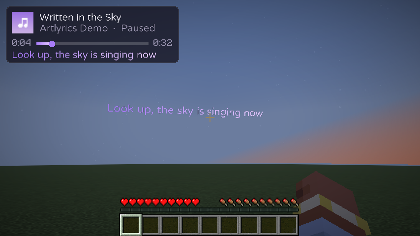
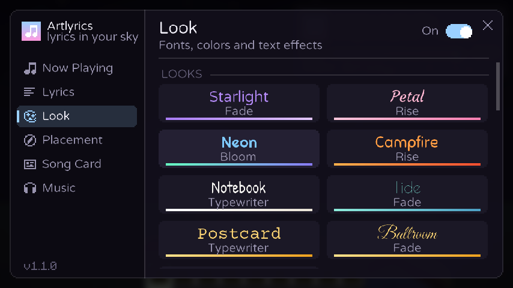
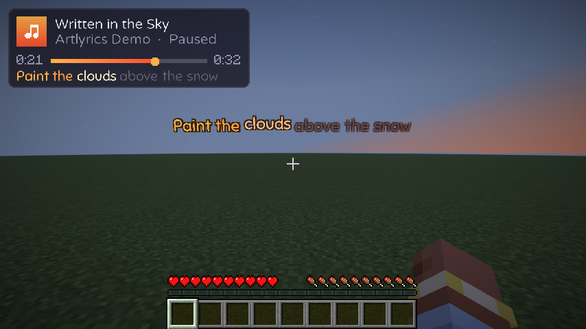

# Artlyrics

A client-side Fabric mod for **Minecraft 1.21.11** that turns the song you're listening to into live, synced
lyrics drawn in the world around you.



| Settings (Look page) | Hover mode with the Campfire look |
| --- | --- |
|  |  |

- **Skywriting**: each line is written across the sky where you were looking when it started, then slowly
  drifts upward. It's part of the world, so hills and trees can get in the way.
- **Hover**: lines hang just above your crosshair and trail a little behind as you turn. Nothing covers them.
- **Smooth text**: sixteen bundled fonts (Soft, Bold, Script, Fancy, Handwritten, Deco, Bubbly, Typewriter,
  Rounded, Brush, Retro, Arcade, Poster, Classic, Elegant, Notes) rendered at high resolution, plus Minecraft's own
  fonts, with a soft glow, shadow or outline in an automatic color, white, black or the palette's accent.
- **Animations**: *Fade*, *Rise* (letters float up one by one), *Bloom*, *Typewriter*, *Sweep* (a karaoke fill that
  glides through each word as it's sung) and *Spotlight*,
  with adjustable speed, how long lines linger and how they leave (float away, fade or shrink).
- **Looks**: one-click combinations of font, palette, effect and animation (Starlight, Petal, Neon, Campfire,
  Notebook, Tide, Postcard, Ballroom, Blocky).
- **Palettes** named after Minecraft materials (Amethyst, Cherry, Ember, Prismarine, Honey, Moss, Quartz, Redstone,
  Lapis, Emerald, Diamond, Copper, Crimson, Warped, Sculk, End, Snow, Sunset), the shifting Aurora, a flowing
  Rainbow, or your own colors.
- **Menu themes**: Dark, Light, Midnight, Glass (see-through), Ocean, Forest and Sakura, for the settings and the
  song card.
- **Song card**: a small card with the song's cover picture, title, artist, progress and the current line, in the
  corner you pick, at the size and opacity you like. Animated covers (GIF) play on the card. The **Player** style
  makes it bigger, with a record that slides out from behind the cover and spins, and bars that bounce along with
  the sung words.
- **Skies**: seventeen animated skies drawn by your graphics card (see below), with live previews, only at night
  if you like.
- **Demo song**: a short built-in song so you can try every look without playing music.

## Where lyrics come from

Artlyrics checks these in order and uses the first one with timed lyrics:

1. **Your lyrics folder**, `config/artlyrics/lyrics`. Put files there for songs no website has: `Artist - Title.lrc`
   (with timestamps) or `Artist - Title.txt` (plain text). **Open folder** on the Music page opens it.
2. **[LRCLIB](https://lrclib.net)**, a free, open lyrics database. When it has word-level timing for a song, words
   appear exactly as they're sung.
3. **NetEase Cloud Music**, a large music service whose public web API has synced lyrics for many songs LRCLIB
   doesn't have.

Matching is forgiving: capital letters, accents ("Prata Vetra" finds "Prāta Vētra"), "feat." credits and tags like
"(Official Video)" or "Remastered" don't matter, and titles stored as "Artist - Title" are recognised.

If no source has timestamps but one has the words, Artlyrics still shows them: it spreads the lines over the song
by how long each is to sing, with a pause between verses. That timing is a guess, so press `[` or `]` while the
song plays to move its lyrics earlier or later; Artlyrics remembers the correction for that song. (Turn this off
with **Lyrics without timing** on the Music page.)

## Installing

1. Install [Fabric Loader](https://fabricmc.net/use/) for Minecraft 1.21.11.
2. Put these in your `mods` folder:
   - `artlyrics-<version>.jar` (build it as described below, or take it from a release)
   - [Fabric API](https://modrinth.com/mod/fabric-api) for 1.21.11
   - optional: [Mod Menu](https://modrinth.com/mod/modmenu), which adds a settings button to the mod list
3. Start the game and play a song in Spotify (or another player).

## How it finds the song

Artlyrics only reads what your computer already knows is playing. It doesn't need your Spotify login.

| OS | How | Notes |
| --- | --- | --- |
| Windows 10/11 | System media controls, through a small PowerShell helper | Works with the Spotify app, browsers (YouTube, Spotify Web, ...) and most players that show up in the Windows volume pop-up. The helper is written to `config/artlyrics/media-windows.ps1` so you can read it. It closes when Minecraft does. |
| macOS | Spotify and Apple Music, through AppleScript (JXA) | The first time, macOS asks whether Minecraft/Java may control Spotify or Music. Allow it. |
| Linux | MPRIS, through `playerctl` | Install `playerctl` (for example `sudo apt install playerctl`). |

When several players are active, Artlyrics follows the one that's playing, and prefers the one named under
**Preferred player** (default: `spotify`).

The only network requests the mod makes go to the lyrics sites (`lrclib.net` and `music.163.com`) and, for covers,
`itunes.apple.com` and the picture address the player names. They contain the track's title, artist, album and
length. Each can be switched off in the settings.

## Media controls

Turn on **Media controls** (Music page, or Quick settings on Now Playing) to get previous, play / pause and next
buttons on the Now Playing page, plus keys for them (unbound by default, under Controls → Artlyrics). They work with
Spotify, browsers and other players through the system's media controls (Windows media controls, MPRIS with
`playerctl` on Linux, Spotify and Apple Music on macOS), no login needed.

**Like** and **Add to playlist** need your Spotify account, once:

1. On [developer.spotify.com/dashboard](https://developer.spotify.com/dashboard) (the **Open** button), create an
   app. Any name works. Set its Redirect URI to `http://127.0.0.1:43821/callback` and tick "Web API".
2. Copy the app's **Client ID**, then press **Paste** next to "Spotify Client ID" on the Music page.
3. Press **Connect** and log in to Spotify in the browser that opens.

Artlyrics never sees your password. It keeps a login token in `config/artlyrics/spotify.json` that lets it save
songs and change your playlists; **Disconnect** deletes it.

## Updates

Artlyrics keeps itself up to date from this repository: when a newer `Artlyrics-<version>-mc<minecraft>.jar` for
your Minecraft version appears in `downloads/` (on `main` or the development branch), it's found when you start
Minecraft. On the Music page, **Updates** can be:

- **Automatic** (default): the new jar is downloaded in the background, checked (size, Git checksum, that it's
  Artlyrics of that version) and saved next to the old one as `.jar.download`. When Minecraft closes, a small
  helper deletes the old jar and puts the new one in its place, so the next start uses the new version. A chat
  message tells you when an update is ready, and **Quit game** finishes it right away.
- **Tell me**: a chat message says a new version is available; **Update to …** on the Music page installs it.
- **Off**.

If anything goes wrong the old version keeps working, and an unfinished update is completed at the next start.

## Holiday themes

Artlyrics dresses up for the holidays where you are. Pick your **Region** on the Holidays page (or leave it on
**Auto**, which uses your computer's region), and around each holiday the lyrics, the song card and the menu take
on its colors, with matching decorations floating around the lyrics and over the card: snow at Christmas,
fireworks at New Year, lanterns at Seollal and the Lunar New Year, hearts for Valentine's Day, a harvest moon at
Chuseok, flowers at Midsummer and Easter, leaves at Thanksgiving, and the flag's colors (with confetti) on
national days. Small holidays give way to a big one close by.

- **Holiday seasons** shows a theme in the days around each holiday (all of December for Christmas, a few days
  for a flag day); **Always nearest** always uses the nearest holiday; **Off** turns it off.
- **Try a theme** shows any holiday's look right away.
- Holiday colors and decorations can be switched off separately.

Regions: Latvia, Lithuania, Estonia, Finland, Sweden, Norway, Denmark, Germany, Austria, Switzerland, the
Netherlands, Belgium, France, Spain, Portugal, Italy, the United Kingdom, Ireland, Poland, Czechia, Slovakia,
Hungary, Romania, Bulgaria, Greece, Croatia, Serbia, Ukraine, Türkiye, the United States, Canada, Mexico, Brazil,
South Korea, Japan, China, Taiwan, India and Australia. Movable dates are worked out for every year: Easter
(Orthodox Easter for Ukraine, Romania, Bulgaria, Greece and Serbia), Midsummer, Thanksgiving, and the lunar
calendar's Seollal, Chuseok, Buddha's Birthday, the Spring, Lantern, Dragon Boat and Mid-Autumn Festivals, Diwali
and Holi.

## Skies

The Skies page changes what the sky looks like. Every sky is drawn by your graphics card, pixel by pixel, right
after Minecraft's own sky, so hills, trees, clouds and the lyrics stay in front of it. Each tile on the page is a
live preview, drawn the same way.

| Sky | What's in it |
| --- | --- |
| Minecraft | the normal sky |
| Milky Way | the band of our galaxy rising from the horizon, with dark dust lanes and thousands of stars |
| Ringed Planet | a banded gas giant lit from the side, with rings that cast a shadow and a small moon |
| Spiral Galaxy | a tilted spiral galaxy turning slowly: blue arms, pink star-forming knots, a golden core |
| Aurora | green and violet curtains of light rippling across the northern sky |
| Eclipse | the sun hidden by the moon: streaming corona, red prominences, the diamond ring and a sunset all around the horizon |
| Black Hole | a glowing disk around a black hole that bends the stars and the disk's far side around itself |
| Nebula | a colorful cloud of glowing gas and dark dust with young stars inside |
| Twin Moons | a big moon and a small rose-colored one, with thin clouds drifting past |
| Moon Halo | the full moon with a ring of ice-crystal light, moon dogs either side and glittering frost |
| Meteor Shower | shooting stars streaking out from one point, now and then a green fireball |
| Great Comet | a bright comet with a curved dust tail and a straight blue ion tail |
| Light Pillars | columns of light rising from the horizon all around |
| Star Rift | a crack across the sky with another starfield glowing through it |
| Sky Lanterns | warm paper lanterns drifting up into the night |
| Sakura Dusk | a pink evening sky with soft clouds and petals falling |
| Golden Hour | a low sun with rays, glowing clouds and a warm sky |
| Synth Sunset | a striped neon sun sinking into a purple sky |

- **Only at night** fades the sky in at dusk and away at dawn.
- **Strength** sets how much it covers the normal sky.
- **Movement** sets how fast things move (0 keeps them still).
- **Stars** turns the stars on or off.
- **Detail** (Low, Medium, High) trades detail for speed on slower graphics cards.

Skies show in the Overworld only, fade in rain, and hide under water or when blinded. Near the horizon they blend
into Minecraft's own sky and fog, so far land fits in day or night. If a graphics card can't run the sky shader, a
simpler version is drawn instead. All the skies were made for Artlyrics.

## Cover pictures

The song card shows the song's cover, taken from (in this order):

1. **Your covers folder**, `config/artlyrics/covers`: a picture named `Artist - Title.gif` (or `.png`, `.jpg`,
   `.bmp`), or named after the album. Animated GIFs play on the card, so this is how you give any song an animated
   cover. **Covers folder** on the Song Card page opens it.
2. **The music player**: on Windows the picture Spotify, browsers and other players show in the volume pop-up; on
   Linux the player's MPRIS picture; on macOS Spotify's artwork.
3. **iTunes search** (switch off with **Find covers online**), when the player shares no picture.

Covers fade in when the song changes, and **Big cover** makes the picture larger. Animated covers from the player
work when the player shares a GIF. Spotify's looping Canvas videos and Apple Music's moving covers are videos only
those apps can play, so they show as a still picture.

## Controls

| Key | Action |
| --- | --- |
| `K` | Open Artlyrics settings (or use Mod Menu) |
| *unbound* | Turn lyrics on/off |
| *unbound* | Switch between Skywriting and Hover |
| `[` | This song's lyrics earlier (by 0.25 s per press, remembered per song) |
| `]` | This song's lyrics later |

Change them under Options → Controls → Key Binds → Artlyrics.

## Settings

Press `K` (or use Mod Menu) to open the settings. Changes apply live, and the world keeps running behind the
screen, so turn on **Demo song** and watch while you adjust.

| Page | What's there |
| --- | --- |
| Home | A welcome banner with your sky, shortcuts to the main pages, and what's playing (with media controls when they're on) |
| Now Playing | The current song and cover, whether lyrics were found, the line being sung, media controls, quick settings, detection status |
| Lyrics | Mode, animation, animation speed, exit style, how long lines linger, sync offset, this song's timing, whole line at once, next-line preview and its visibility |
| Holidays | Holiday themes (seasons / always nearest / off), region, holiday colors, decorations, try a theme, what's on now and coming up |
| Skies | Seventeen GPU-drawn skies with live previews, only at night, strength, movement, stars, detail |
| Look | Menu theme, looks, fonts, palettes (with a custom color editor), text effect, glow, size, opacity, line width, bold, italic, ALL CAPS |
| Placement | Skywriting height, distance, scatter, drift and arc; hover distance, height and how quickly it follows your view |
| Song Card | Show or hide, style (Compact or Player, with the record and moving bars), position, size, background, artist, progress, next-line preview, album cover, big cover, animated covers, find covers online, covers folder, with a live preview |
| Music | Preferred player, media controls, Spotify account, updates |
| Sources | Look lyrics up again, lyrics sources (your folder, LRCLIB, NetEase, lyrics without timing), covers online, covers folder |

Settings are saved in `config/artlyrics.json`, per-song timing in `config/artlyrics/song-timing.json`.

## Troubleshooting

- **"No lyrics found"**: no source has this song, or the player reports an unusual title. Artlyrics already
  retries with cleaned-up titles and free-text searches. You can add the lyrics yourself in the lyrics folder.
- **"No timed lyrics for this song"**: a source has the words but no timestamps, and **Lyrics without timing** is
  off. Turn it on to see them with estimated timing.
- **Lyrics are early or late**: press `[` / `]` to fix this song, or adjust **Sync offset** for all songs. Some
  browsers report the playback position coarsely.
- **Nothing is detected on Linux**: check that `playerctl metadata` works in a terminal.

## Building

Requires JDK 21.

```sh
./gradlew build          # mod jar in build/libs/artlyrics-<version>+mc1.21.11.jar
./gradlew test           # unit tests for the lyrics parsers and matching
./gradlew test -Dartlyrics.liveTests=true   # also query the real LRCLIB API (including Latvian songs)
./gradlew runClient      # launch Minecraft with the mod (add -Dartlyrics.demo=true to the JVM args to start the demo song)
./gradlew runClientGameTest   # launch the game, play the demo song and save screenshots of each mode
./gradlew test -Dartlyrics.uiPreview=true   # draw every settings page and the song card to build/ui-preview/*.png
```

The UI preview doesn't start Minecraft: the settings screen and song card draw through a small `Canvas` interface,
which the test implements with Java2D using Minecraft's own glyph sheets and the bundled fonts.

The game-test screenshots end up in `build/run/clientGameTest/screenshots/` (the images above come from it). It also
checks that every bundled font loads. It needs Minecraft's game assets, which `./gradlew downloadAssets` fetches; without
them the resource reload fails and the screenshots come out black.

## Project layout

```
src/main/java/com/artlyrics/
  ArtlyricsClient.java     entrypoint: events, keybinds
  nowplaying/              detecting the playing song (Windows / macOS / Linux / demo) and a smoothed clock
  lyrics/                  LRCLIB client, LRC and word-synced parsers, timing estimation, lookup cache
  render/                  Skywriting / Hover renderer, skies, fonts, song card HUD
  sky/                     the sky themes (drawn by assets/artlyrics/shaders/include/sky.glsl)
  ui/                      settings screen and song card, drawn through the Canvas interface
  screen/                  Minecraft screen that hosts the settings UI
  config/                  settings, palettes and looks
src/main/resources/assets/artlyrics/
  font/                    bundled TrueType fonts and their Minecraft font definitions
  licenses/                the fonts' licenses (SIL Open Font License 1.1)
src/gametest/              client game test that takes screenshots
```

## ArtWeb (a second mod in this repository)

The `artweb/` folder holds **ArtWeb**, a separate mod for Minecraft 1.21.9 / 1.21.10 that adds Web Screen
blocks: place one, type a web address, and the page appears on the block for everyone nearby. See
[artweb/README.md](artweb/README.md). Its jar is in `downloads/` next to the Artlyrics jars.

## Credits

Lyrics are provided by [LRCLIB](https://lrclib.net). The demo song's lyrics were written for this mod.

Bundled fonts, all under the [SIL Open Font License 1.1](https://openfontlicense.org) (license texts in
`src/main/resources/assets/artlyrics/licenses/`): Varela Round (Soft), Righteous (Bold), Courgette (Script),
Great Vibes (Fancy), Patrick Hand (Handwritten), Poiret One (Deco), Sniglet (Bubbly), Courier Prime
(Typewriter), Comfortaa (Rounded), Pacifico (Brush), Lobster (Retro), Press Start 2P (Arcade), Bebas Neue
(Poster), Cinzel (Classic), Playfair Display (Elegant) and Caveat (Notes), from
[Google Fonts](https://github.com/google/fonts).
