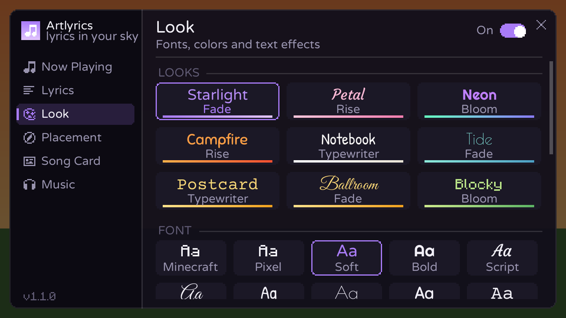

# Artlyrics

A client-side Fabric mod for **Minecraft 1.21.11** that turns the song you're listening to into live, synced
lyrics drawn in the world around you.



- **Skywriting**: each line is written across the sky where you were looking when it started, then slowly
  drifts upward. It's part of the world, so hills and trees can get in the way.
- **Hover**: lines hang just above your crosshair and trail a little behind as you turn. Nothing covers them.
- **Smooth text**: eight bundled fonts (Soft, Bold, Script, Fancy, Handwritten, Deco, Bubbly, Typewriter) rendered
  at high resolution, plus Minecraft's own fonts, with a soft glow, shadow or outline.
- **Animations**: *Fade*, *Rise* (letters float up one by one), *Bloom*, *Typewriter*, *Sweep* and *Spotlight*,
  with adjustable speed, how long lines linger and how they leave (float away, fade or shrink).
- **Looks**: one-click combinations of font, palette, effect and animation (Starlight, Petal, Neon, Campfire,
  Notebook, Tide, Postcard, Ballroom, Blocky).
- **Palettes** named after Minecraft materials (Amethyst, Cherry, Ember, Prismarine, Honey, Moss, Quartz, the
  shifting Aurora) or your own colors.
- **Song card**: a small card with the title, artist, progress and the current line, in the corner you pick,
  at the size and opacity you like.
- **Demo song**: a short built-in song so you can try every look without playing music.

Lyrics come from [LRCLIB](https://lrclib.net), a free, open lyrics database. When LRCLIB has word-level timing
for a song, words appear exactly as they're sung; otherwise Artlyrics estimates word timing from the line
timestamps.

## Installing

1. Install [Fabric Loader](https://fabricmc.net/use/) for Minecraft 1.21.11.
2. Put these in your `mods` folder:
   - `artlyrics-<version>.jar` (build it as described below, or take it from a release)
   - [Fabric API](https://modrinth.com/mod/fabric-api) for 1.21.11
   - optional: [Mod Menu](https://modrinth.com/mod/modmenu), which adds a settings button to the mod list
3. Start the game and play a song in Spotify (or another player).

## How it finds the song

Artlyrics only reads what your computer already knows is playing. It doesn't need your Spotify login.

| OS | How | Notes |
| --- | --- | --- |
| Windows 10/11 | System media controls, through a small PowerShell helper | Works with the Spotify app, browsers (YouTube, Spotify Web, ...) and most players that show up in the Windows volume pop-up. The helper is written to `config/artlyrics/media-windows.ps1` so you can read it. It closes when Minecraft does. |
| macOS | Spotify and Apple Music, through AppleScript (JXA) | The first time, macOS asks whether Minecraft/Java may control Spotify or Music. Allow it. |
| Linux | MPRIS, through `playerctl` | Install `playerctl` (for example `sudo apt install playerctl`). |

When several players are active, Artlyrics follows the one that's playing, and prefers the one named under
**Preferred player** (default: `spotify`).

The only network requests the mod makes go to `lrclib.net`, and they contain the track's title, artist, album and length.

## Controls

| Key | Action |
| --- | --- |
| `K` | Open Artlyrics settings (or use Mod Menu) |
| *unbound* | Turn lyrics on/off |
| *unbound* | Switch between Skywriting and Hover |

Change them under Options → Controls → Key Binds → Artlyrics.

## Settings

Press `K` (or use Mod Menu) to open the settings. Changes apply live, and the world keeps running behind the
screen, so turn on **Demo song** and watch while you adjust.

| Page | What's there |
| --- | --- |
| Now Playing | The current song, whether lyrics were found, the line being sung, quick settings |
| Lyrics | Mode, animation, animation speed, exit style, how long lines linger, sync offset |
| Look | Looks, fonts, palettes (with a custom color editor), text effect, glow, size, opacity, line width, bold, italic, ALL CAPS |
| Placement | Skywriting height, distance, scatter, drift and arc; hover distance, height and how quickly it follows your view |
| Song Card | Show or hide, position, size, background, artist, progress, next-line preview, with a live preview |
| Music | Preferred player, demo song, look lyrics up again, detection status |

Settings are saved in `config/artlyrics.json`.

## Troubleshooting

- **"No lyrics found"**: LRCLIB doesn't have this song yet, or the player reports an unusual title.
  Artlyrics already retries with cleaned-up titles (dropping things like "Official Video" or "Remastered").
- **"No timed lyrics for this song"**: LRCLIB has the words but no timestamps, so they can't be synced.
- **Lyrics are early or late**: adjust **Sync offset**. Some browsers report the playback position coarsely.
- **Nothing is detected on Linux**: check that `playerctl metadata` works in a terminal.

## Building

Requires JDK 21.

```sh
./gradlew build          # mod jar in build/libs/artlyrics-<version>+mc1.21.11.jar
./gradlew test           # unit tests for the lyrics parsers and matching
./gradlew test -Dartlyrics.liveTests=true   # also query the real LRCLIB API
./gradlew runClient      # launch Minecraft with the mod (add -Dartlyrics.demo=true to the JVM args to start the demo song)
./gradlew runClientGameTest   # launch the game, play the demo song and save screenshots of each mode
./gradlew test -Dartlyrics.uiPreview=true   # draw every settings page and the song card to build/ui-preview/*.png
```

The UI preview doesn't start Minecraft: the settings screen and song card draw through a small `Canvas` interface,
which the test implements with Java2D using Minecraft's own glyph sheets and the bundled fonts.

The game-test screenshots end up in `build/run/clientGameTest/screenshots/`. The game test needs a machine with a
real GPU; on headless software rendering (Mesa llvmpipe) Minecraft 1.21.11 only produces black frames.

## Project layout

```
src/main/java/com/artlyrics/
  ArtlyricsClient.java     entrypoint: events, keybinds
  nowplaying/              detecting the playing song (Windows / macOS / Linux / demo) and a smoothed clock
  lyrics/                  LRCLIB client, LRC and word-synced parsers, timing estimation, lookup cache
  render/                  Skywriting / Hover renderer, fonts, song card HUD
  ui/                      settings screen and song card, drawn through the Canvas interface
  screen/                  Minecraft screen that hosts the settings UI
  config/                  settings, palettes and looks
src/main/resources/assets/artlyrics/
  font/                    bundled TrueType fonts and their Minecraft font definitions
  licenses/                the fonts' licenses (SIL Open Font License 1.1)
src/gametest/              client game test that takes screenshots
```

## Credits

Lyrics are provided by [LRCLIB](https://lrclib.net). The demo song's lyrics were written for this mod.

Bundled fonts, all under the [SIL Open Font License 1.1](https://openfontlicense.org) (license texts in
`src/main/resources/assets/artlyrics/licenses/`): Varela Round (Soft), Righteous (Bold), Courgette (Script),
Great Vibes (Fancy), Patrick Hand (Handwritten), Poiret One (Deco), Sniglet (Bubbly) and Courier Prime
(Typewriter), from [Google Fonts](https://github.com/google/fonts).
