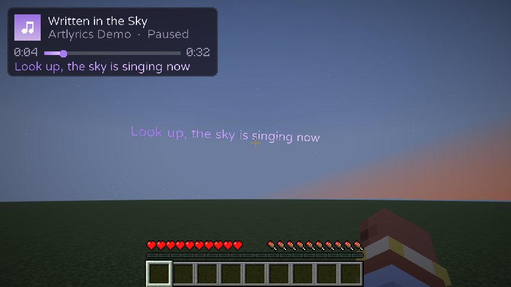
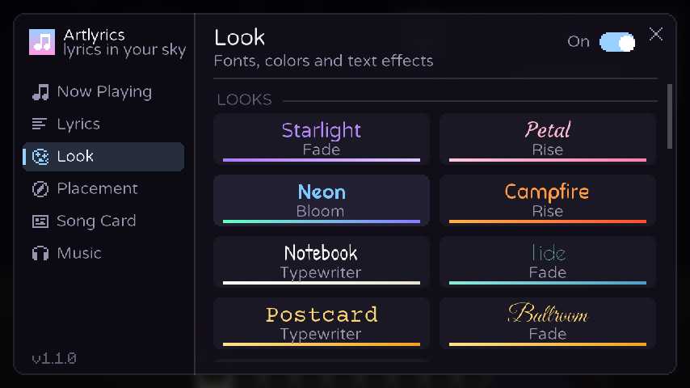
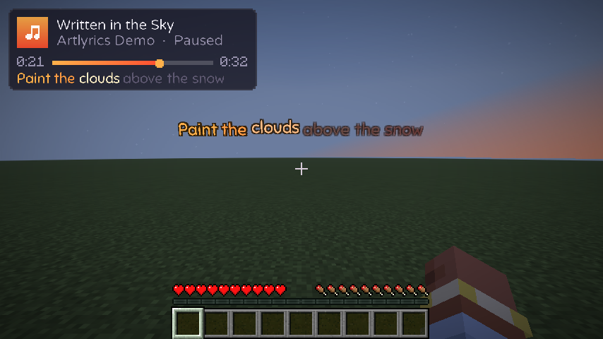

# Artlyrics

A client-side Fabric mod for **Minecraft 1.21.11** that turns the song you're listening to into live, synced
lyrics drawn in the world around you.



| Settings (Look page) | Hover mode with the Campfire look |
| --- | --- |
|  |  |

- **Skywriting**: each line is written across the sky where you were looking when it started, then slowly
  drifts upward. It's part of the world, so hills and trees can get in the way.
- **Hover**: lines hang just above your crosshair and trail a little behind as you turn. Nothing covers them.
- **Smooth text**: eight bundled fonts (Soft, Bold, Script, Fancy, Handwritten, Deco, Bubbly, Typewriter) rendered
  at high resolution, plus Minecraft's own fonts, with a soft glow, shadow or outline.
- **Animations**: *Fade*, *Rise* (letters float up one by one), *Bloom*, *Typewriter*, *Sweep* (a karaoke fill that
  glides through each word as it's sung) and *Spotlight*,
  with adjustable speed, how long lines linger and how they leave (float away, fade or shrink).
- **Looks**: one-click combinations of font, palette, effect and animation (Starlight, Petal, Neon, Campfire,
  Notebook, Tide, Postcard, Ballroom, Blocky).
- **Palettes** named after Minecraft materials (Amethyst, Cherry, Ember, Prismarine, Honey, Moss, Quartz, the
  shifting Aurora) or your own colors.
- **Song card**: a small card with the title, artist, progress and the current line, in the corner you pick,
  at the size and opacity you like.
- **Demo song**: a short built-in song so you can try every look without playing music.

## Where lyrics come from

Artlyrics checks these in order and uses the first one with timed lyrics:

1. **Your lyrics folder**, `config/artlyrics/lyrics`. Put files there for songs no website has: `Artist - Title.lrc`
   (with timestamps) or `Artist - Title.txt` (plain text). **Open folder** on the Music page opens it.
2. **[LRCLIB](https://lrclib.net)**, a free, open lyrics database. When it has word-level timing for a song, words
   appear exactly as they're sung.
3. **NetEase Cloud Music**, a large music service whose public web API has synced lyrics for many songs LRCLIB
   doesn't have.

Matching is forgiving: capital letters, accents ("Prata Vetra" finds "Prāta Vētra"), "feat." credits and tags like
"(Official Video)" or "Remastered" don't matter, and titles stored as "Artist - Title" are recognised.

If no source has timestamps but one has the words, Artlyrics still shows them: it spreads the lines over the song
by how long each is to sing, with a pause between verses. That timing is a guess, so press `[` or `]` while the
song plays to move its lyrics earlier or later; Artlyrics remembers the correction for that song. (Turn this off
with **Lyrics without timing** on the Music page.)

## Installing

1. Install [Fabric Loader](https://fabricmc.net/use/) for Minecraft 1.21.11.
2. Put these in your `mods` folder:
   - `artlyrics-<version>.jar` (build it as described below, or take it from a release)
   - [Fabric API](https://modrinth.com/mod/fabric-api) for 1.21.11
   - optional: [Mod Menu](https://modrinth.com/mod/modmenu), which adds a settings button to the mod list
3. Start the game and play a song in Spotify (or another player).

## How it finds the song

Artlyrics only reads what your computer already knows is playing. It doesn't need your Spotify login.

| OS | How | Notes |
| --- | --- | --- |
| Windows 10/11 | System media controls, through a small PowerShell helper | Works with the Spotify app, browsers (YouTube, Spotify Web, ...) and most players that show up in the Windows volume pop-up. The helper is written to `config/artlyrics/media-windows.ps1` so you can read it. It closes when Minecraft does. |
| macOS | Spotify and Apple Music, through AppleScript (JXA) | The first time, macOS asks whether Minecraft/Java may control Spotify or Music. Allow it. |
| Linux | MPRIS, through `playerctl` | Install `playerctl` (for example `sudo apt install playerctl`). |

When several players are active, Artlyrics follows the one that's playing, and prefers the one named under
**Preferred player** (default: `spotify`).

The only network requests the mod makes go to the lyrics sites (`lrclib.net` and `music.163.com`), and they contain
the track's title, artist, album and length. Switch either off on the Music page.

## Controls

| Key | Action |
| --- | --- |
| `K` | Open Artlyrics settings (or use Mod Menu) |
| *unbound* | Turn lyrics on/off |
| *unbound* | Switch between Skywriting and Hover |
| `[` | This song's lyrics earlier (by 0.25 s per press, remembered per song) |
| `]` | This song's lyrics later |

Change them under Options → Controls → Key Binds → Artlyrics.

## Settings

Press `K` (or use Mod Menu) to open the settings. Changes apply live, and the world keeps running behind the
screen, so turn on **Demo song** and watch while you adjust.

| Page | What's there |
| --- | --- |
| Now Playing | The current song, whether lyrics were found, the line being sung, quick settings |
| Lyrics | Mode, animation, animation speed, exit style, how long lines linger, sync offset, this song's timing, whole line at once, next-line preview and its visibility |
| Look | Looks, fonts, palettes (with a custom color editor), text effect, glow, size, opacity, line width, bold, italic, ALL CAPS |
| Placement | Skywriting height, distance, scatter, drift and arc; hover distance, height and how quickly it follows your view |
| Song Card | Show or hide, position, size, background, artist, progress, next-line preview, with a live preview |
| Music | Preferred player, demo song, look lyrics up again, lyrics sources (your folder, LRCLIB, NetEase, lyrics without timing), detection status |

Settings are saved in `config/artlyrics.json`, per-song timing in `config/artlyrics/song-timing.json`.

## Troubleshooting

- **"No lyrics found"**: no source has this song, or the player reports an unusual title. Artlyrics already
  retries with cleaned-up titles and free-text searches. You can add the lyrics yourself in the lyrics folder.
- **"No timed lyrics for this song"**: a source has the words but no timestamps, and **Lyrics without timing** is
  off. Turn it on to see them with estimated timing.
- **Lyrics are early or late**: press `[` / `]` to fix this song, or adjust **Sync offset** for all songs. Some
  browsers report the playback position coarsely.
- **Nothing is detected on Linux**: check that `playerctl metadata` works in a terminal.

## Building

Requires JDK 21.

```sh
./gradlew build          # mod jar in build/libs/artlyrics-<version>+mc1.21.11.jar
./gradlew test           # unit tests for the lyrics parsers and matching
./gradlew test -Dartlyrics.liveTests=true   # also query the real LRCLIB API (including Latvian songs)
./gradlew runClient      # launch Minecraft with the mod (add -Dartlyrics.demo=true to the JVM args to start the demo song)
./gradlew runClientGameTest   # launch the game, play the demo song and save screenshots of each mode
./gradlew test -Dartlyrics.uiPreview=true   # draw every settings page and the song card to build/ui-preview/*.png
```

The UI preview doesn't start Minecraft: the settings screen and song card draw through a small `Canvas` interface,
which the test implements with Java2D using Minecraft's own glyph sheets and the bundled fonts.

The game-test screenshots end up in `build/run/clientGameTest/screenshots/` (the images above come from it). It also
checks that every bundled font loads. It needs Minecraft's game assets, which `./gradlew downloadAssets` fetches; without
them the resource reload fails and the screenshots come out black.

## Project layout

```
src/main/java/com/artlyrics/
  ArtlyricsClient.java     entrypoint: events, keybinds
  nowplaying/              detecting the playing song (Windows / macOS / Linux / demo) and a smoothed clock
  lyrics/                  LRCLIB client, LRC and word-synced parsers, timing estimation, lookup cache
  render/                  Skywriting / Hover renderer, fonts, song card HUD
  ui/                      settings screen and song card, drawn through the Canvas interface
  screen/                  Minecraft screen that hosts the settings UI
  config/                  settings, palettes and looks
src/main/resources/assets/artlyrics/
  font/                    bundled TrueType fonts and their Minecraft font definitions
  licenses/                the fonts' licenses (SIL Open Font License 1.1)
src/gametest/              client game test that takes screenshots
```

## ArtWeb (a second mod in this repository)

The `artweb/` folder holds **ArtWeb**, a separate mod for Minecraft 1.21.9 / 1.21.10 that adds Web Screen
blocks: place one, type a web address, and the page appears on the block for everyone nearby. See
[artweb/README.md](artweb/README.md). Its jar is in `downloads/` next to the Artlyrics jars.

## Credits

Lyrics are provided by [LRCLIB](https://lrclib.net). The demo song's lyrics were written for this mod.

Bundled fonts, all under the [SIL Open Font License 1.1](https://openfontlicense.org) (license texts in
`src/main/resources/assets/artlyrics/licenses/`): Varela Round (Soft), Righteous (Bold), Courgette (Script),
Great Vibes (Fancy), Patrick Hand (Handwritten), Poiret One (Deco), Sniglet (Bubbly) and Courier Prime
(Typewriter), from [Google Fonts](https://github.com/google/fonts).
