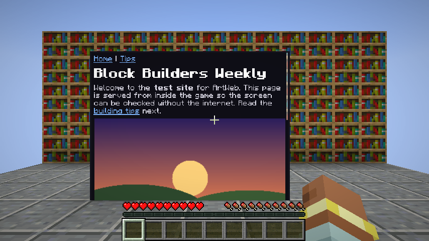
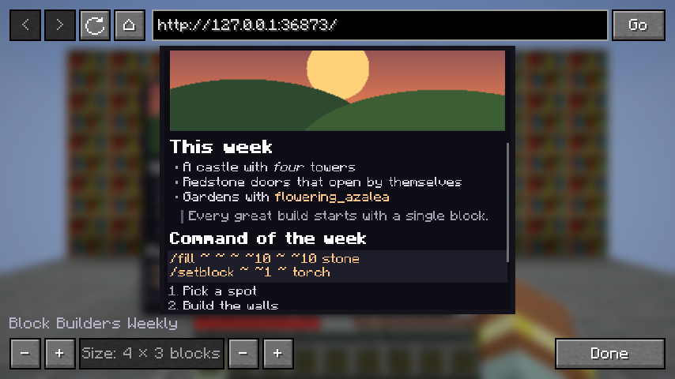

# ArtWeb

A Fabric mod for **Minecraft 1.21.9 and 1.21.10** that adds **Web Screens**: place a screen block, type a web
address, and the page appears on the block for everyone nearby.

| A 4 × 3 Web Screen | The browser window |
| --- | --- |
|  |  |

## Using it

1. Craft a **Web Screen** (or take it from the *Functional Blocks* tab in creative):

   | | | |
   | --- | --- | --- |
   | Iron Ingot | Iron Ingot | Iron Ingot |
   | Iron Ingot | Glass Pane | Iron Ingot |
   | Iron Ingot | Redstone | Iron Ingot |

2. Place it. The screen faces you, and the picture grows **to your right and upwards** from the block.
3. Right-click the block, or anywhere on its picture, to open the browser window (sneak to place blocks
   against it instead):
   - Type an address (`minecraft.net`, `https://en.wikipedia.org/wiki/Redstone`) or just some words to search
     the web (DuckDuckGo), then press Enter or **Go**.
   - **<** and **>** go back and forward, **↻** reloads, **⌂** goes to the home page.
   - Scroll with the mouse wheel (or the arrow keys, Page Up/Down, Home and End). Click a link to follow it.
   - The **−/+** buttons at the bottom change the screen's size, from 1 × 1 up to 8 × 6 blocks.
4. Close the window. The block shows the same page at the same scroll position, for every player.

## What it can show

ArtWeb has its own small page reader, not a full browser engine. It shows a page's **text, headings, lists,
quotes, code, links and pictures** (PNG, JPEG, GIF, BMP), the way a "reader mode" would. It doesn't run
JavaScript, so it can't show videos, games, logins or sites built entirely with JavaScript (it tells you when a
page needs JavaScript). Articles, wikis, news, documentation and blogs work well. Forms, other than search
through the address bar, don't work.

Each player's game downloads the page itself, so a screen shows the same page to everyone even on a server
that has no internet access.

## Notes

- **Multiplayer**: the mod must be installed on the server and on every player's game. Players in Adventure
  mode, or more than 32 blocks away, can't change a screen.
- A screen placed by someone else makes your game open that address when you come near it, like a link someone
  sends you would. Only `http` and `https` addresses are opened.
- The picture is only drawn: you can walk through the part that extends past the block.

## Installing

1. Install [Fabric Loader](https://fabricmc.net/use/) for Minecraft 1.21.9 or 1.21.10.
2. Put `ArtWeb-1.0.0-mc1.21.9.jar` (from `downloads/`) and [Fabric API](https://modrinth.com/mod/fabric-api) for
   your Minecraft version in the `mods` folder. On a server, put both in the server's `mods` folder too.

## Building

```
./gradlew -p artweb build            # the jar is in artweb/build/libs
./gradlew -p artweb test             # unit tests
./gradlew -p artweb runClientGameTest   # starts the game, serves a test site and takes screenshots
```

The HTML reader is [jsoup](https://jsoup.org) (MIT licence), included in the jar.
